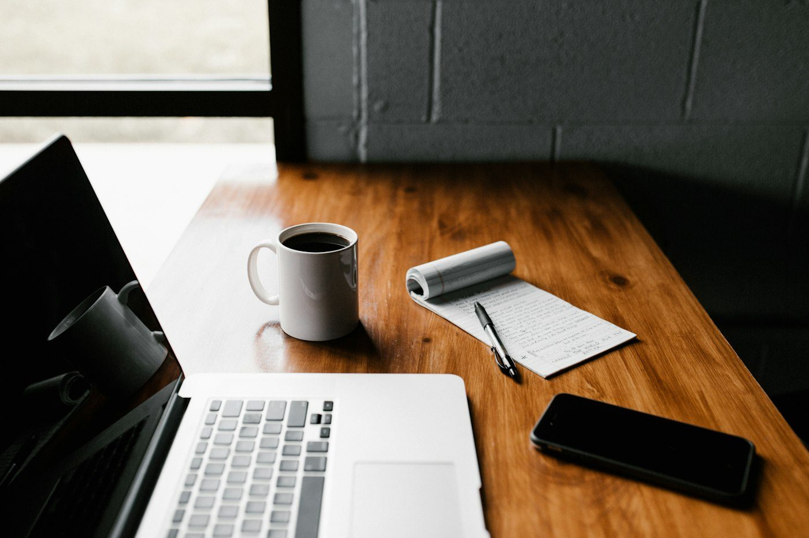

上个月我把自己这个网站删了一半。不是重做，是删——侧边栏、头像、每篇文章的封面图、底部的「相关阅读」、还有那个一直在右下角晃的订阅按钮。

删完之后页面空了很多。奇怪的是，我盯着它看了很久，第一次觉得它像是我自己的东西。

## 先说结论

留白不是「没有内容」，而是**把说话的权力还给内容本身**。页面上每一个额外的元素都在喊话，喊得越多，正文的声音就越小。

具体到操作层面，我用的判断只有一句话：

> 删掉之后，如果读者获取信息的路径变短了，那就删对了。如果变长了——比如少了目录、少了日期——那就说明这个元素其实在干活，得留下。

## 我删掉了什么

清单如下。每一条后面都写了我当时的理由，以及删掉之后的实际感受。

- **侧边栏**——里面有标签云、归档、友链。实际上我自己半年没点过。
- **文章封面图**——最该删的一项。为了让它好看，我要花二十分钟找一张跟正文没关系的图。
- **「相关阅读」**——它把注意力从「读完了」拉到了「再读一篇」，而后者本来该由我自己决定。
- **右下角的订阅气泡**——滚动到 40% 就弹出来，像在文章中间插了一只手。
- **阅读进度条**——我原本以为它很贴心，后来发现它只会让人焦虑。

删到一半的时候我意识到一件事：*这些东西全都不是为读者准备的，是为「一个网站应该有这些东西」准备的。*

## 为什么删掉之后更好读

我去掉侧边栏之后，正文的可用宽度从 620px 涨到了 760px。看起来只是变宽了一点，但中文一行能放的字数从 36 个变成了 42 个——正好越过了「一行读起来有点累」的那条线。



还有一个更隐蔽的收益：**加载变快了**。我从 380KB 的首屏资源降到了 46KB，没有任何专项优化，纯粹是因为删掉了东西。

> 好的排版不是把字排得漂亮，是让读者忘记自己正在看一个网页。

## 留白不是空的

这里有个容易搞反的地方。留白不等于把东西都扔了、让页面变得很空——那样只会显得冷漠。留白是**用空间表达层级**。

具体来说，我最后留下的这套东西是这样的：

1. 标题和正文之间的间距，是段落间距的 2.4 倍。读者不用思考就知道这里开始新的章节了。
2. 正文最大宽度 40rem，行高 1.85。中文需要比英文更大的行距，因为方块字没有升部降部来提供视觉节奏。
3. 分隔只用一条 1px 的线，透明度压到 4%。它存在，但不抢戏。
4. 整个站点只有一个强调色，只用在链接和焦点上。

这套东西后来被我抄进了 CSS 变量，改一个数字，全站跟着变：

```css
:root {
  --measure: 40rem;              /* 正文宽度，中文约 38 字/行 */
  --line-1: rgba(0, 0, 0, .04);  /* 分隔线：存在，但不抢戏 */
  --accent: #4176e6;             /* 全站唯一强调色 */
}

.prose {
  font-size: 16.5px;
  line-height: 1.85;   /* 中文需要比英文更大的行距 */
  text-wrap: pretty;   /* 避免最后一行只剩一个字 */
}
```

## 留下来的东西

最后我保留了四样：日期、标题、正文，和一个能让我把图放进去的位置。就这些。

半年后回看，这篇文章本身也变短了——因为我删掉了三段「为了显得完整」而写的过渡段落。留白这件事，一旦开始就停不下来。

---

如果你也在收拾自己的网站，我很好奇你删掉的第一样东西是什么。写信告诉我。
